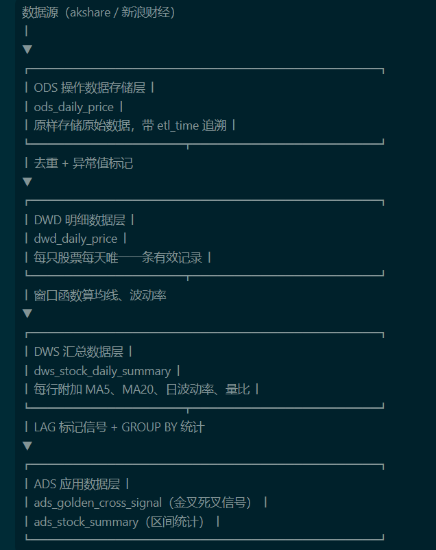

# **A股量化策略研究与数据管道**

> 一个从零构建的量化项目：既包含完整的策略研究流程（双均线回测、过滤条件测试、跨标的验证），也包含基于 SQLite 的分层 ETL 数仓（ODS → DWD → DWS → ADS），两者构成"数据加工 → 策略验证"的完整链路。

---

## **📌 项目概述**

本项目分为三个模块，对应量化工作中三种不同的能力：

| 模块 | 核心内容 | 对应能力 |
| :--- | :--- | :--- |
| **模块一：策略研究** | 双均线回测、参数敏感性分析、ADX/RSI/成交量过滤条件测试、10 只股票跨标的验证 | 量化研究、策略评估、过拟合识别 |
| **模块二：单表 ETL** | akshare 数据获取、SQLite 单表存储、SQL 窗口函数计算均线、LAG 标记金叉死叉、GROUP BY 聚合统计 | 数据开发、SQL、金融数据处理 |
| **模块三：分层 ETL 数仓** | ODS/DWD/DWS/ADS 四层建模、去重与异常值标记、窗口函数汇总、LAG 产出信号、GROUP BY 区间统计 | 数仓建模、ETL 流程、数据质量管理 |

**三个模块的关系：**
数据源（akshare）
->
模块三：分层 ETL 数仓（run_etl.py）
ODS → DWD → DWS → ADS
->
模块一：策略研究（aks_use_entire.py）
从 ADS 读取信号，做回测验证
->
模块二：单表 ETL（sqlite_pipeline.py）
作为重构前的对比版本保留


**一句话总结**：用 Python 做策略研究，用 SQL 做数据加工，从单表 ETL 演进到分层数仓，最终让策略回测消费数仓的 ADS 层数据。三个模块不是孤立的 demo，而是一条完整的"数据工程 → 数仓 → 应用"链路。

---

## **🛠️ 技术栈**

- **Python 3.10+** — 数据获取、策略回测、ETL 调度
- **akshare** — A 股历史行情数据获取（东方财富 / 新浪财经双源）
- **pandas / numpy** — 数据清洗与向量化计算
- **sqlite3** — 金融数据存储与数仓落地
- **SQL** — 窗口函数、LAG、ROW_NUMBER、GROUP BY 等数仓加工
- **matplotlib** — 交易信号可视化
- **os / datetime** — 代理环境处理、ETL 时间戳

---

## **📂 项目结构**

text

```
├── aks_use_entire.py # 模块一：策略研究（双均线回测 + 过滤条件测试）
├── sqlite_pipeline.py # 模块二：单表 ETL（对比版本）
├── run_etl.py # 模块三：分层 ETL 数仓（ODS → DWD → DWS → ADS）
├── stock_data.db # ETL 数仓数据库（ODS/DWD/DWS/ADS 四层表）
├── stock_data_legacy.db # 单表 ETL 的旧数据库（对比用）
├── param_comparison_*.csv # 各股票参数对比结果
├── sh600519_茅台（消费）_trading_signals.png # 交易信号图
├── README.md # 项目说明
└── CONCEPTS.md # 金融概念解析
```

---

**模块与文件对应关系：**

| 模块 | 主文件 | 输出 |
| :--- | :--- | :--- |
| 模块一：策略研究 | `aks_use_entire.py` | 回测绩效、参数对比 CSV、信号图 PNG |
| 模块二：单表 ETL | `sqlite_pipeline.py` | `stock_data_legacy.db`（单表 `daily_price`） |
| 模块三：分层 ETL 数仓 | `run_etl.py` | `stock_data.db`（四层表：ODS/DWD/DWS/ADS） |

## **📈 模块一：策略研究**

### **策略逻辑**

**基础策略：双均线趋势跟踪**

- **金叉买入**：短期均线（MA_short）上穿长期均线（MA_long）
- **死叉卖出**：短期均线下穿长期均线

**交易成本模拟**

| **成本类型** | **费率** | **说明** |
| --- | --- | --- |
| 佣金 | 0.03% | 买卖双向收取 |
| 印花税 | 0.1% | 仅卖出时收取 |

> 初始资金：500 万元；最小交易单位：100 股（1 手）。
> 

**绩效指标**

| **指标** | **计算方式** |
| --- | --- |
| 累计收益率 | `(总资产 / 初始资金) - 1` |
| 夏普比率 | `(年化收益 - 无风险利率) / 年化波动率` |
| 最大回撤 (MDD) | `min((总资产 - 历史最高) / 历史最高)` |
| 胜率 | `盈利交易数 / 总交易数` |
| 盈亏比 | `总盈利 / 总亏损` |

### **参数敏感性分析**

对以下 5 组均线参数在同一区间（2020-2026，贵州茅台）进行回测：

| **参数组合** | **累计收益率** | **夏普比率** | **最大回撤** | **胜率** | **盈亏比** | **交易次数** |
| --- | --- | --- | --- | --- | --- | --- |
| MA5/MA20 | +15.38% | 0.07 | -40.33% | 32.61% | 1.20 | 46 |
| MA10/MA30 | +7.32% | 0.00 | -40.47% | 26.92% | 1.12 | 26 |
| MA5/MA60 | +25.35% | 0.14 | -37.39% | 39.13% | 1.56 | 23 |
| MA10/MA60 | +20.87% | 0.11 | -41.15% | 33.33% | 1.53 | 18 |
| **MA20/MA60** | **+36.36%** | **0.22** | -39.68% | **50.00%** | **1.76** | **14** |

**核心发现：**

1. **长周期均线表现更稳健**：MA20/MA60 收益最高（+36.36%），夏普最高（0.22），胜率最高（50%）。
2. **短周期均线交易频繁但亏损**：MA5/MA20 交易 46 次，收益仅 +15.38%，说明频繁交易增加了成本。
3. **所有参数组合的最大回撤均在 -37% 至 -41% 之间**：单纯的趋势跟踪策略在 A 股市场需要更严格的风险控制。

### **过滤条件实验**

在双均线策略基础上，分别测试 ADX、RSI、成交量三个过滤条件：

| **过滤条件** | **买入条件** |
| --- | --- |
| **ADX 过滤** | 金叉 + ADX > 25 + +DI > -DI |
| **RSI 过滤** | 金叉 + 50 < RSI < 阈值 |
| **成交量过滤** | 金叉 + 当日成交量 > 20 日均量的 1.5 倍 |

#### **ADX 过滤：长区间全部恶化**

| **ADX 阈值** | **累计收益率** | **夏普比率** | **最大回撤** | **胜率** | **盈亏比** | **交易次数** |
| --- | --- | --- | --- | --- | --- | --- |
| **无过滤（基准）** | **+15.38%** | **0.07** | -40.33% | 32.61% | 1.20 | 46 |
| > 20 | -27.17% | -0.87 | -29.47% | 12.50% | 0.24 | 16 |
| > 25 | -12.90% | -0.69 | -20.42% | 12.50% | 0.42 | 8 |
| > 30 | -2.61% | -0.70 | -10.40% | 25.00% | 0.81 | 4 |
| > 35 | -3.21% | -1.79 | -5.48% | 0.00% | 0.00 | 1 |

#### **短区间 vs 长区间：过拟合验证**

| **区间** | **基准版收益** | **ADX>25 收益** | **ADX 过滤效果** |
| --- | --- | --- | --- |
| 2025-2026（1年） | -2.66% | **+4.04%** | ✅ 改善 |
| 2020-2026（6年） | **+15.38%** | -12.90% | ❌ 恶化 |

**核心发现：**

1. **短区间有效，长区间恶化**：ADX > 25 在 1 年区间使收益从 -2.66% 提升到 +4.04%，但在 6 年区间使收益从 +15.38% 降至 -12.90%。这是典型的过拟合特征。
2. **ADX 的两次平滑导致信号严重滞后**：当 ADX 确认趋势时，行情可能已经走完大半，导致买入即被套。
3. **教训**：任何单一指标过滤条件，必须在多个时间尺度上验证。

#### **RSI 过滤：单调改善，但存在行业分化**

| **RSI 高阈值** | **累计收益率** | **夏普比率** | **交易次数** |
| --- | --- | --- | --- |
| 无过滤（基准） | +15.38% | 0.07 | 46 |
| RSI < 60 | **+46.30%** | **0.30** | 30 |
| RSI < 65 | +42.73% | 0.27 | 32 |
| RSI < 70 | +32.10% | 0.19 | 34 |
| RSI < 75 | +32.10% | 0.19 | 34 |
| RSI < 80 | +26.76% | 0.15 | 35 |

**跨标的验证（10 只股票，2020-2026，MA5/MA20）：**

| **股票** | **类型** | **基准** | **仅ADX** | **仅RSI** | **仅成交量** |
| --- | --- | --- | --- | --- | --- |
| 贵州茅台 | 消费 | +15.38% | -9.29% | **+32.10%** | +8.49% |
| 五粮液 | 消费 | +28.77% | -25.97% | **+46.62%** | +14.77% |
| 招商银行 | 金融 | +29.49% | -6.77% | -2.96% | **+19.54%** |
| 比亚迪 | 新能源 | +24.79% | -2.33% | **+63.39%** | -32.30% |
| 中国平安 | 保险 | -19.33% | -4.13% | -10.79% | -25.54% |
| 美的集团 | 家电 | -9.26% | +7.86% | -5.56% | -4.73% |
| 长江电力 | 公用事业 | -2.42% | -5.32% | +1.72% | +2.58% |
| 宁德时代 | 新能源 | +15.02% | -24.81% | **+133.16%** | -37.53% |
| 紫金矿业 | 资源 | +166.78% | +12.78% | +104.55% | -2.76% |
| 格力电器 | 家电 | -44.24% | -13.55% | -39.22% | +5.09% |

**核心发现：**

1. **ADX 过滤在 10 只股票上全部恶化**：收益降幅在 -2pp 至 -154pp 之间，结论高度一致。
2. **RSI 过滤呈现明显的行业分化**：
    - 消费股（茅台、五粮液）和新能源股（比亚迪、宁德时代）大幅改善
    - 金融股（招行、平安）和资源股（紫金矿业）明显恶化
3. **分化背后的逻辑**：
    - **消费股/新能源股**：均值回归特征强，RSI 高时买入容易买在短期高点
    - **金融股/资源股**：趋势延续性强，RSI 高时买入可能赶上主升浪
4. **成交量过滤表现最不稳定**：改善和恶化的股票数量接近，且交易次数普遍过少（3-13 次）。

### **策略研究核心结论**

1. **没有任何单一过滤条件在所有标的上都有效**。过滤条件的有效性高度依赖标的的行业特征。
2. **回撤降低不等于策略变好**。ADX 和成交量版本的回撤改善，是以砍掉 85%-93% 的交易为代价的。
3. **单一时间尺度验证不可靠**。ADX 过滤在 1 年区间改善，6 年区间恶化，是典型的过拟合。


---

## **🗄️ 模块二：数据管道（SQLite + SQL）**

### **数据写入**

用 `sqlite3` 将 akshare 拉取的日线数据写入 `daily_price` 表：

sql

```sql
CREATE TABLE daily_price (
    id INTEGER PRIMARY KEY AUTOINCREMENT,
    symbol TEXT NOT NULL,
    trade_date TEXT NOT NULL,
    open REAL, high REAL, low REAL, close REAL, volume REAL,
    UNIQUE(symbol, trade_date)
);
```

python

```python
import sqlite3
import akshare as ak

def fetch_and_store(symbols, start_date, end_date):
    conn = sqlite3.connect('stock_data.db')
    cursor = conn.cursor()

    for symbol in symbols:
        df = ak.stock_zh_a_hist(
            symbol=symbol.replace('sh', '').replace('sz', ''),
            period="daily",
            start_date=start_date.replace('-', ''),
            end_date=end_date.replace('-', ''),
            adjust="qfq"
        )
        df = df.rename(columns={
            '日期': 'date', '开盘': 'open', '收盘': 'close',
            '最高': 'high', '最低': 'low', '成交量': 'volume'
        })

        for _, row in df.iterrows():
            cursor.execute('''
                INSERT OR IGNORE INTO daily_price
                (symbol, trade_date, open, high, low, close, volume)
                VALUES (?, ?, ?, ?, ?, ?, ?)
            ''', (symbol, str(row['date']), float(row['open']),
                  float(row['high']), float(row['low']),
                  float(row['close']), float(row['volume'])))

        conn.commit()
    conn.close()
```

### **SQL 窗口函数计算均线**

sql

```sql
AVG(close) OVER (
    PARTITION BY symbol
    ORDER BY trade_date
    ROWS BETWEEN 4 PRECEDING AND CURRENT ROW
) AS ma_5
```

### **LAG 标记金叉死叉**

sql

```sql
CASE
    WHEN prev_short <= prev_long AND ma_short > ma_long THEN '金叉'
    WHEN prev_short >= prev_long AND ma_short < ma_long THEN '死叉'
END AS signal
```

完整查询：

sql

```sql
WITH ma_calc AS (
    SELECT symbol, trade_date, close,
        AVG(close) OVER (PARTITION BY symbol ORDER BY trade_date
                         ROWS BETWEEN 4 PRECEDING AND CURRENT ROW) AS ma_short,
        AVG(close) OVER (PARTITION BY symbol ORDER BY trade_date
                         ROWS BETWEEN 19 PRECEDING AND CURRENT ROW) AS ma_long
    FROM daily_price WHERE symbol = ?
),
signal_calc AS (
    SELECT *,
        LAG(ma_short) OVER (PARTITION BY symbol ORDER BY trade_date) AS prev_short,
        LAG(ma_long)  OVER (PARTITION BY symbol ORDER BY trade_date) AS prev_long
    FROM ma_calc
)
SELECT symbol, trade_date, close,
    ROUND(ma_short, 2) AS ma_short, ROUND(ma_long, 2) AS ma_long,
    CASE
        WHEN prev_short <= prev_long AND ma_short > ma_long THEN '金叉'
        WHEN prev_short >= prev_long AND ma_short < ma_long THEN '死叉'
    END AS signal
FROM signal_calc ORDER BY trade_date
```

### **GROUP BY 统计**

sql

```sql
SELECT
    symbol,
    COUNT(*) AS trading_days,
    MIN(trade_date) AS first_date,
    MAX(trade_date) AS last_date,
    ROUND(MIN(low), 2) AS min_price,
    ROUND(MAX(high), 2) AS max_price,
    ROUND(AVG(close), 2) AS avg_close
FROM daily_price
GROUP BY symbol
ORDER BY trading_days DESC
```

### **运行结果**

**各股票交易天数统计：**

| **symbol** | **trading_days** | **first_date** | **last_date** | **min_price** | **max_price** | **avg_close** |
| --- | --- | --- | --- | --- | --- | --- |
| sh600036 | 727 | 2023-01-03 | 2025-12-31 | 26.90 | 48.55 | 36.80 |
| sh600519 | 727 | 2023-01-03 | 2025-12-31 | 1245.83 | 1935.00 | 1604.48 |
| sz000858 | 727 | 2023-01-03 | 2025-12-31 | 105.61 | 219.89 | 145.10 |
| sz002594 | 727 | 2023-01-03 | 2025-12-31 | 91.70 | 416.98 | 242.69 |

**MA5/MA20 金叉死叉信号（茅台，部分）：**

| **symbol** | **trade_date** | **close** | **ma_short** | **ma_long** | **signal** |
| --- | --- | --- | --- | --- | --- |
| sh600519 | 2023-01-10 | 1854.45 | 1805.09 | 1792.57 | 金叉 |
| sh600519 | 2023-02-06 | 1795.00 | 1827.97 | 1840.17 | 死叉 |
| sh600519 | 2023-02-20 | 1875.00 | 1848.48 | 1843.84 | 金叉 |
| sh600519 | 2023-02-27 | 1810.41 | 1823.88 | 1828.35 | 死叉 |
| ... | ... | ... | ... | ... | ... |


---

## 模块三：ETL 数仓（ODS → DWD → DWS → ADS）
 
### 为什么做这个模块

模块一（策略研究）和模块二（单表 ETL）都是"从原始数据直接算到结果"，逻辑混在一起。实际工作中，金融数据通常要经过分层加工：原始数据先原样落地，再清洗，再汇总，最后产出分析结果。这个模块把之前的单表逻辑重构为 **ODS → DWD → DWS → ADS 四层数仓**，演示金融行情数据的标准 ETL 流程。

### 分层架构



### 各层核心 SQL

#### ODS 层：原样存储

```sql
CREATE TABLE IF NOT EXISTS ods_daily_price (
    id INTEGER PRIMARY KEY AUTOINCREMENT,
    symbol TEXT NOT NULL,
    trade_date TEXT NOT NULL,
    open REAL, high REAL, low REAL, close REAL, volume REAL,
    etl_time TEXT NOT NULL,
    UNIQUE(symbol, trade_date, etl_time)
);
```

ODS 层不做清洗，只做列名映射（中文 → 英文）和 etl_time 记录。多次抽取会累积重复记录，去重是 DWD 层的事。


#### DWD 层：去重 + 异常值标记
```sql
CREATE TABLE dwd_daily_price AS
WITH dedup AS (
    SELECT *,
           ROW_NUMBER() OVER (
               PARTITION BY symbol, trade_date
               ORDER BY etl_time DESC
           ) AS rn
    FROM ods_daily_price
),
flagged AS (
    SELECT *,
           CASE
               WHEN close <= 0 OR open <= 0 OR high <= 0 OR low <= 0 THEN 1
               WHEN high < low THEN 1
               WHEN volume < 0 THEN 1
               ELSE 0
           END AS is_invalid
    FROM dedup
    WHERE rn = 1
)
SELECT symbol, trade_date, open, high, low, close, volume, etl_time
FROM flagged
WHERE is_invalid = 0;
```

ROW_NUMBER() OVER (PARTITION BY symbol, trade_date ORDER BY etl_time DESC)：每只股票每天只保留最新一次抽取

CASE WHEN：标记异常值而不是直接过滤，保留"为什么被过滤"的信息


#### DWS 层：窗口函数算均线
```sql
CREATE TABLE dws_stock_daily_summary AS
WITH base AS (
    SELECT symbol, trade_date, close, high, low, volume
    FROM dwd_daily_price
),
ma_calc AS (
    SELECT
        symbol, trade_date, close, high, low, volume,
        AVG(close) OVER (
            PARTITION BY symbol ORDER BY trade_date
            ROWS BETWEEN 4 PRECEDING AND CURRENT ROW
        ) AS ma5,
        AVG(close) OVER (
            PARTITION BY symbol ORDER BY trade_date
            ROWS BETWEEN 19 PRECEDING AND CURRENT ROW
        ) AS ma20,
        AVG(volume) OVER (
            PARTITION BY symbol ORDER BY trade_date
            ROWS BETWEEN 19 PRECEDING AND CURRENT ROW
        ) AS vol_ma20
    FROM base
)
SELECT
    symbol, trade_date, close,
    ROUND(ma5, 2) AS ma5,
    ROUND(ma20, 2) AS ma20,
    ROUND((high - low) / close, 4) AS daily_volatility,
    ROUND(volume / vol_ma20, 4) AS volume_ratio
FROM ma_calc;
```

DWS 保留每天的明细行（2908 条 = 4 只股票 × 727 天），只是在每行上附加计算字段。用 AVG() OVER (ROWS BETWEEN N PRECEDING AND CURRENT ROW) 而不是 GROUP BY，因为 GROUP BY 会把多行合并成一行，丢失每日明细。


#### ADS 层：LAG 标记金叉死叉 + GROUP BY 统计
```sql
-- 表1：金叉死叉信号
CREATE TABLE ads_golden_cross_signal AS
WITH signal_calc AS (
    SELECT
        symbol, trade_date, close, ma5, ma20,
        LAG(ma5) OVER (PARTITION BY symbol ORDER BY trade_date) AS prev_ma5,
        LAG(ma20) OVER (PARTITION BY symbol ORDER BY trade_date) AS prev_ma20
    FROM dws_stock_daily_summary
)
SELECT
    symbol, trade_date, close, ma5, ma20,
    CASE
        WHEN prev_ma5 IS NULL OR prev_ma20 IS NULL THEN NULL
        WHEN prev_ma5 <= prev_ma20 AND ma5 > ma20 THEN '金叉'
        WHEN prev_ma5 >= prev_ma20 AND ma5 < ma20 THEN '死叉'
        ELSE NULL
    END AS signal
FROM signal_calc
WHERE signal IS NOT NULL;

-- 表2：每只股票区间统计
CREATE TABLE ads_stock_summary AS
SELECT
    symbol,
    COUNT(*) AS trading_days,
    MIN(trade_date) AS first_date,
    MAX(trade_date) AS last_date,
    ROUND(MIN(close), 2) AS min_close,
    ROUND(MAX(close), 2) AS max_close,
    ROUND(AVG(close), 2) AS avg_close,
    ROUND((MAX(close) - MIN(close)) / MIN(close) * 100, 2) AS range_pct
FROM dws_stock_daily_summary
GROUP BY symbol;
```

运行结果
[DWD] ODS 原始记录: 5816 条
[DWD] DWD 有效记录: 2908 条
[DWD] 被过滤/去重: 2908 条
[DWS] DWD 明细记录: 2908 条
[DWS] DWS 汇总记录: 2908 条
[ADS] 金叉死叉信号记录: 195 条
[ADS] 股票区间统计记录: 4 条


数据质量验证：

检查项	结果
DWD 去重后记录数	2908 = 4 只股票 × 727 天 ✅
金叉/死叉数量	招行 21/21、茅台 26/26、五粮液 21/21、比亚迪 30/29 ✅
信号交替	金叉 → 死叉 → 金叉 → 死叉，无连续同向信号 ✅
ADS 区间统计结果：

symbol	trading_days	first_date	last_date	min_close	max_close	avg_close	range_pct
sh600036	727	2023-01-03	2025-12-31	27.03	48.24	36.80	78.47%
sh600519	727	2023-01-03	2025-12-31	1261.00	1912.90	1604.48	51.70%
sz000858	727	2023-01-03	2025-12-31	105.94	217.60	145.10	105.40%
sz002594	727	2023-01-03	2025-12-31	92.70	405.00	242.69	336.89%
设计要点
分层职责清晰：ODS 只存，DWD 清洗，DWS 汇总，ADS 出结果。每层只做一件事，出问题时可以逐层排查。

幂等性：每层用 DROP TABLE IF EXISTS + CREATE TABLE AS 重建，跑多少次结果一致。

可追溯：ODS 的 etl_time 记录每次抽取时间，DWD 保留最新一次，可以追溯数据来源。

SQL 与 Pandas 的适用场景：数据存储在数仓时用 SQL 在库内计算，避免拉全量数据到内存；复杂策略回测用 Pandas 逐行模拟交易。两者互补，不是替代关系。


### **SQL vs Pandas 的适用场景**

| **场景** | **推荐方式** | **原因** |
| --- | --- | --- |
| **数据存储在数仓** | SQL | 在数据库层计算，无需拉取全部数据到内存 |
| **复杂策略回测** | Pandas | 需要逐行模拟交易，SQL 不擅长 |
| **指标计算（均线/RSI）** | SQL 或 Pandas | SQL 窗口函数更简洁；Pandas 更灵活 |
| **多表关联** | SQL | JOIN 在数据库层完成，效率更高 |
| **参数敏感性分析** | Pandas | 需要循环多组参数，Python 更方便 |

## **🧠 核心结论与能力展示**

### **数据工程能力**

- 用 Python + SQLite 搭建数据管道，支持多标的批量写入
- 用 SQL 窗口函数完成均线计算，用 LAG 标记金叉死叉
- 用 GROUP BY 完成多维度聚合统计
- 理解 SQL 与 Pandas 的适用场景差异

### **策略研究能力**

- 从零构建双均线策略回测框架（含手续费、印花税）
- 完成参数敏感性分析、过滤条件测试、多时间尺度验证、跨标的验证
- 识别并验证过拟合（ADX 过滤）
- 发现过滤条件的行业分化规律（RSI 在消费/新能源有效，金融/资源失效）


---

## **🔜 后续优化方向**

- [] 用 Hurst 指数或 ADF 检验量化标的的均值回归/趋势延续特征
- [] 测试 RSI 阈值在不同标的上的最优值
- [] 加入止损线，控制最大回撤
- [] 扩展到更多标的（20-30 只），验证行业分化规律的统计显著性
- [] 用 Airflow 替代 Python 循环，实现数据管道调度
- [] 用 Plotly 做交互式可视化
    
    

---

## **⚠️ 免责声明**

本项目仅用于技术学习与策略研究，不构成任何投资建议。历史回测表现不代表未来收益。

---

## **👤 关于作者**

计算机背景，正在向金融数据分析 / 量化开发方向转型。这个项目是我学习过程中的实战练习，欢迎交流指正。